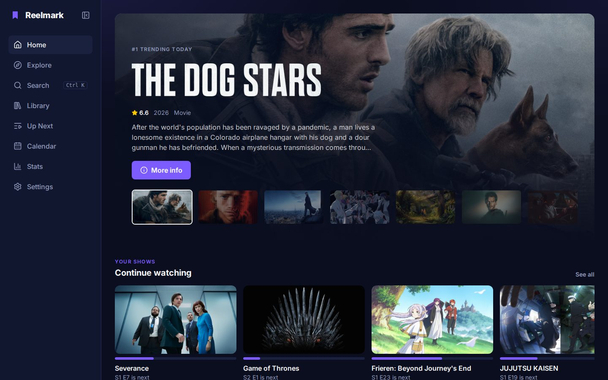
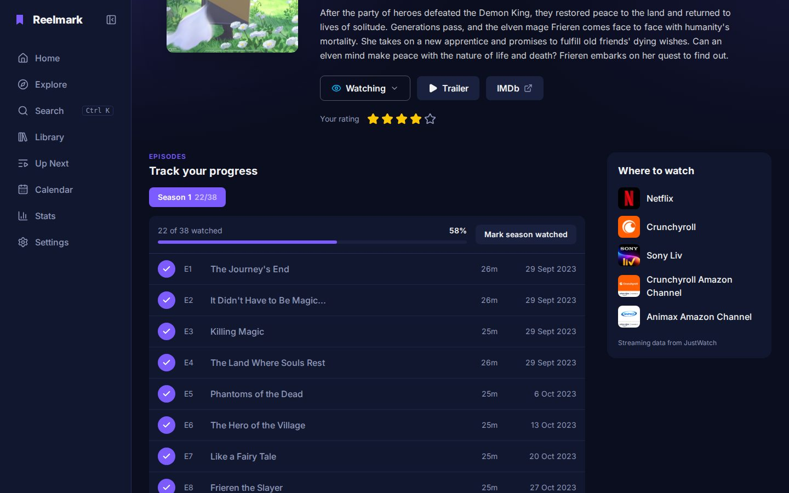
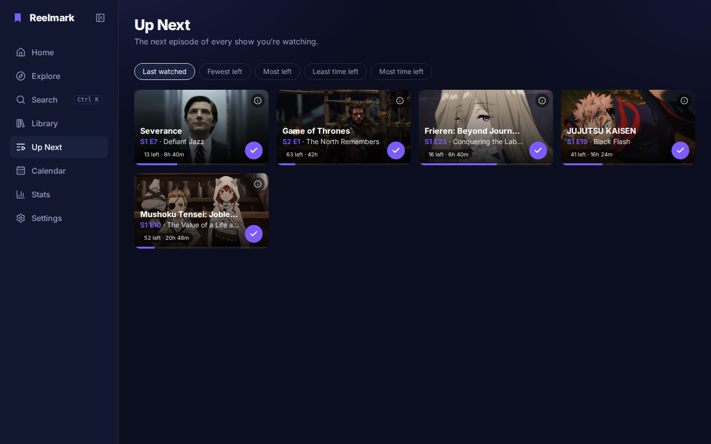
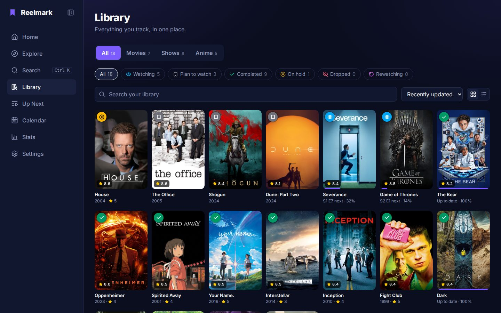
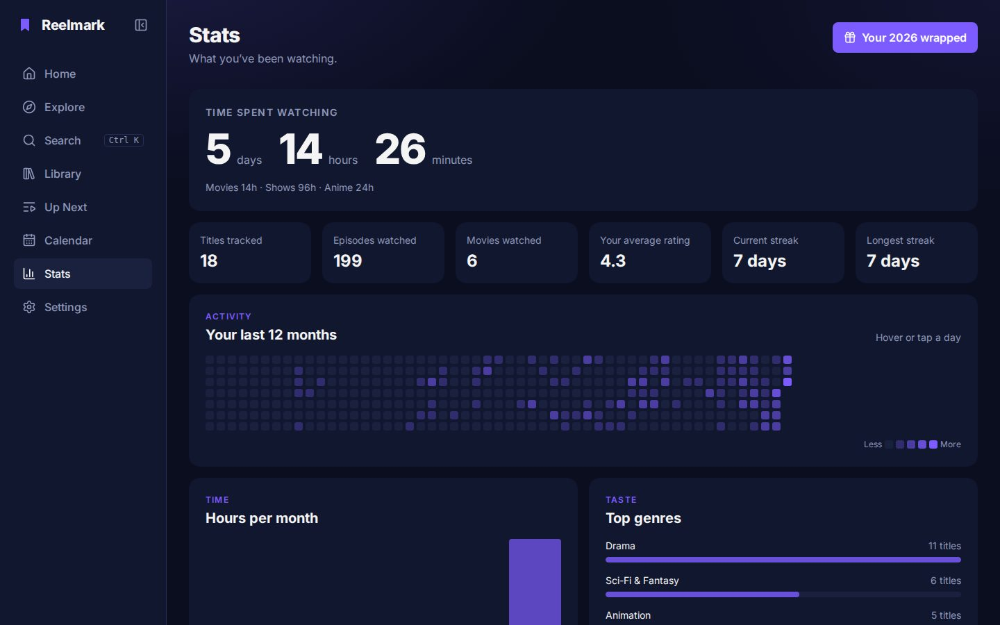
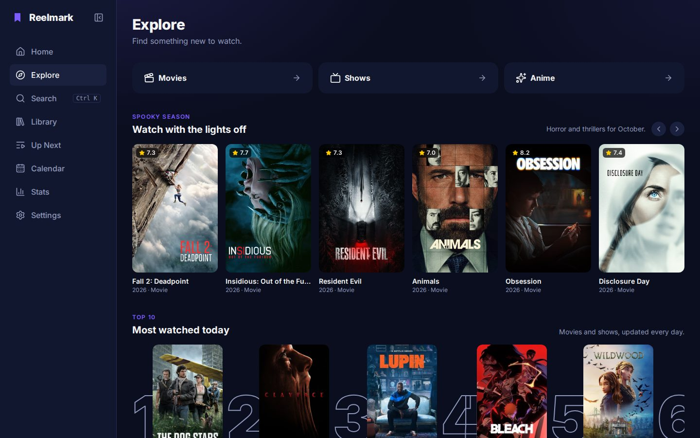

# Reelmark

Keep track of the movies, shows and anime you watch. Tick off episodes, see what's next, and look back at how much you've watched.

**Live:** https://rimjhimyadav.github.io/reelmark/



## Features

- **Home** is all about you: continue watching, new episodes from your shows this week, "because you watched..." picks, and a **what should I watch tonight?** picker that chooses from your Plan to watch list by mood and time. The banner on top shows each title's real logo
- **Explore** has a row that changes with the month (spooky in October, cozy in December...), the newest trailers, top 10 today, coming soon with a countdown, streaming apps in India (Netflix, Prime Video, JioHotstar...), moods, genres, hidden gems and decades, plus a "see all" grid with filters and infinite scroll
- **Search** everything at once, open it from anywhere with `Ctrl + K`
- **Details page** with trailer, cast, reviews, where to watch in India, an IMDb link and similar titles
- **Track** anything as Watching, Plan to watch, Completed, On hold, Dropped or Rewatching (each with its own color), and rate it out of 5
- **Episode tracking** per season. A show moves to Completed by itself when you finish the last episode
- **Spoiler mode** blurs names and pictures of episodes you haven't seen
- **Up Next** shows the next episode of every show you're watching, sorted how you like, with how many episodes and hours are left
- **Calendar** with new episodes and movie releases from your library, click a day to see just that day
- **Stats**: total watch time, streaks, a 12 month activity heatmap, hours per month and top genres
- **Wrapped**: a "your year in watching" card you can download as a picture
- **Settings**: spoiler mode, and export or import your library (it's all saved in your browser)

| Episodes | Up Next |
| --- | --- |
|  |  |

| Library | Stats |
| --- | --- |
|  |  |

| Explore |
| --- |
|  |

## Built with

- React + Vite
- React Router
- Tailwind CSS
- Zustand (the library is saved to localStorage with its `persist` middleware)
- Vitest for the tracking and stats logic
- html-to-image for the wrapped picture
- [TMDB API](https://developer.themoviedb.org/docs) for all movie and show data

## Run it locally

```bash
npm install
cp .env.example .env   # then put your TMDB API key in .env
npm run dev
```

`npm test` runs the tests, `npm run lint` runs ESLint.

## Credits

This product uses the TMDB API but is not endorsed or certified by TMDB. Streaming info comes from JustWatch.
